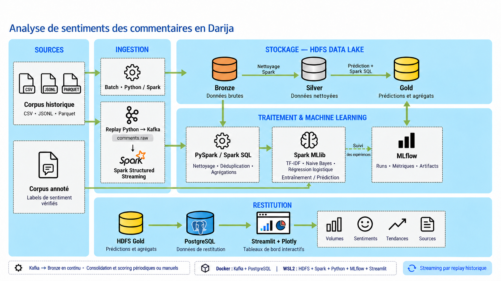

# LahjaLens

Plateforme de Big Data Analytics dédiée à l’analyse automatique des commentaires marocains en darija, arabe et français.



## Architecture

LahjaLens suit l’architecture de référence validée pour l’analyse de sentiments des commentaires en darija :

```text
Corpus historique ──┬──► Batch Python / Spark ──► HDFS Bronze
                    └──► Replay Python → Kafka ──► Spark Structured Streaming
                                                       │
HDFS Bronze ──► Nettoyage Spark ──► HDFS Silver ──► Spark SQL ──► HDFS Gold
                                       │                            │
Corpus annoté ──► Spark MLlib ────────┘                            │
                         │                                          │
                         └────────────► MLflow                      │
                                                                    ▼
                                                   PostgreSQL ──► Streamlit + Plotly
```

## Stack technique

- Python 3.11 et Parquet pour l’ingestion batch
- Hadoop HDFS 3.4.2 comme data lake
- PySpark 3.5.7 en mode local pour les traitements
- Apache Kafka 3.9.x en mode KRaft pour le replay et le streaming
- Spark MLlib pour la classification de sentiment
- MLflow pour le suivi des expériences ML
- PostgreSQL pour la restitution analytique
- Streamlit et Plotly pour les KPI, tendances, thèmes et sources
- Docker Compose pour Kafka et PostgreSQL

## Organisation du développement

Le projet est construit progressivement, fichier par fichier. Chaque étape doit être vérifiée avant de poursuivre. Les données réelles, les données synthétiques de test et les résultats observés doivent rester explicitement distingués.

Le fichier maître attendu est `DARIJAPULSE_CODEX_MASTER_SPEC.md`. Il doit être placé à la racine du dépôt avant toute implémentation dépendant de contrats, chemins HDFS ou critères détaillés.

## Principes

- Ne pas réinstaller Hadoop : HDFS est déjà configuré sous WSL2.
- Respecter les contrats JSON et Parquet définis par la spécification.
- N’entraîner les modèles que sur des exemples avec des labels fiables.
- Utiliser Kafka pour le replay historique ou des événements issus d’une source autorisée.
- Conserver un corpus annoté séparé, avec des labels de sentiment vérifiés, pour l’entraînement.
- Ne jamais inventer de dataset, résultat, métrique ou service fonctionnel.
- Conserver un code Python 3.11 typé, modulaire, testable et compatible avec les ressources disponibles.

## État actuel

Le dépôt contient la documentation, l’infographie, la configuration du cluster Docker, les contrats d’événements et le script de préparation du corpus Hespress. Les jobs Spark, les modèles ML et le dashboard restent à développer.

## Données Hespress : première étape

Les catégories politique, économie, société, sport et art et culture représentent **139 166 commentaires et 5 000 articles**. Les originaux locaux sont conservés dans `data/raw/hespress/v1/`, avec leur provenance et leurs empreintes SHA-256.

Pour reproduire la préparation, avec Python 3.11 ou plus récent et sans dépendance supplémentaire :

```powershell
python scripts/prepare_hespress.py
```

Pour vérifier les fichiers déjà récupérés sans accès réseau :

```powershell
python scripts/prepare_hespress.py --audit-only
```

Le script produit aussi un échantillon de 1 000 commentaires à annoter. Le sentiment et le thème du commentaire ne sont pas inventés ; la rubrique de l’article reste une information de contexte. Les fichiers de données restent exclus de Git.

Voir le [guide du premier TP](docs/datasets/HESPRESS_GUIDE.md), le [rapport d’audit](docs/datasets/HESPRESS_AUDIT.md) et le [choix des datasets](docs/datasets/DATASET_DECISION.md).

---

# Conventions de développement

## Mission du projet

LahjaLens est une plateforme de Data Engineering, Machine Learning, MLOps et Business Intelligence dédiée à l’analyse de commentaires marocains en darija, arabe et français.

L’architecture cible comprend :

- ingestion batch de données historiques en Python et Parquet ;
- événements réels ou explicitement rejoués via Kafka ;
- data lake HDFS organisé en couches Bronze, Silver et Gold ;
- traitements Apache Spark / PySpark, SQL et Structured Streaming ;
- classification de sentiment avec Spark MLlib ;
- suivi des expériences avec MLflow ;
- restitution PostgreSQL et tableau de bord Streamlit + Plotly.

## Règle de progression

Le développement se fait fichier par fichier, dans l’ordre défini par le cahier des charges maître.

À chaque étape :

1. créer ou modifier un seul fichier ;
2. expliquer brièvement les décisions importantes ;
3. fournir les commandes de vérification adaptées ;
4. exécuter les vérifications lorsque l’environnement le permet ;
5. attendre l’instruction explicite `suivant` avant de passer à l’étape suivante.

Ne pas créer de composant supplémentaire, de fichier de configuration ou de code auxiliaire sans demande explicite de l’étape en cours.

## Sources de vérité

- `DARIJAPULSE_CODEX_MASTER_SPEC.md` est la spécification technique de référence lorsqu’il est disponible à la racine du projet.
- En cas de contradiction, appliquer la spécification maître puis demander une clarification avant toute implémentation concernée.
- Ne jamais inventer un dataset, un label, un résultat de test, une métrique, un service fonctionnel ou une donnée métier.
- Distinguer clairement les données réelles, les exemples de documentation et les données synthétiques de test.

## Environnement cible

- Ubuntu 24.04 sous WSL2 ;
- Python 3.11 ;
- Java 11 ;
- Hadoop HDFS 3.4.2 déjà installé et configuré ;
- PySpark 3.5.7 en mode local ;
- Apache Kafka 3.9.x en mode KRaft ;
- MLflow ;
- PostgreSQL ;
- Streamlit et Plotly ;
- Docker Compose pour Kafka et PostgreSQL uniquement lorsque prévu.

Ne pas réinstaller, remplacer ou reconfigurer Hadoop sans demande explicite. Respecter les ressources disponibles : Core Ultra 7, 32 Go de RAM et RTX 5070 avec 8 Go de VRAM. Le GPU est réservé aux extensions Transformer et ne doit pas être rendu obligatoire pour le MVP Spark MLlib.

## Conventions de code

- Écrire du Python compatible avec Python 3.11.
- Préférer un code typé, modulaire, lisible et testable.
- Utiliser des noms explicites et cohérents avec les contrats de données.
- Garder les fonctions courtes et limiter les effets de bord.
- Valider les entrées et produire des erreurs explicites et exploitables.
- Ne pas masquer une erreur par un `except` trop général ou un résultat de remplacement silencieux.
- Éviter les chemins absolus propres à une machine ; centraliser les chemins et paramètres prévus par la spécification.
- Ne pas inscrire de secrets, mots de passe, tokens ou identifiants dans le dépôt.
- Préserver l’encodage UTF-8 pour les textes en darija, arabe et français.

## Données et contrats

- Respecter strictement les schémas JSON et Parquet définis par la spécification maître.
- Conserver la traçabilité de la source, du temps d’ingestion et de l’identifiant d’événement lorsque le contrat le prévoit.
- Ne jamais entraîner un modèle sur des exemples dont les labels ne sont pas fiables ou explicitement documentés.
- Le dataset MSDA peut servir à la classification à trois sentiments si sa structure et ses labels sont vérifiés.
- AtlasIA est réservé, à ce stade, à une éventuelle tâche distincte de détection de la darija.
- Séparer les couches Bronze, Silver et Gold ; ne pas mélanger données brutes et données transformées.
- Les événements Kafka doivent provenir d’une source autorisée ou d’un replay explicitement documenté.

## HDFS, Spark et Kafka

- Utiliser les chemins HDFS définis par la spécification, sans les deviner.
- Vérifier les lectures et écritures réelles avant de déclarer une étape terminée.
- Utiliser le connecteur officiel `spark-sql-kafka-0-10_2.12` pour l’intégration Kafka avec Spark.
- Documenter les prérequis locaux lorsqu’une vérification nécessite HDFS, Kafka, PostgreSQL ou MLflow.
- Ne pas présenter un service comme disponible si son état n’a pas été vérifié.

## Machine Learning et MLOps

- Séparer nettoyage, préparation, entraînement, évaluation et inférence.
- Éviter les fuites de données entre entraînement et évaluation.
- Rapporter les métriques réellement calculées et leur jeu de données de référence.
- Enregistrer dans MLflow uniquement les paramètres, métriques et artefacts effectivement produits.
- Rendre les expériences reproductibles autant que possible avec des graines et une configuration explicites.

## Tests et validation

- Commencer par les vérifications les plus ciblées pour le fichier de l’étape.
- Tester les cas nominaux, les entrées invalides et les cas limites pertinents.
- Pour les composants dépendant d’un service externe, distinguer les tests unitaires des tests d’intégration.
- Ne jamais transformer une absence de service ou de dataset en succès simulé.
- Indiquer la commande exécutée, le résultat observé et toute limite de validation.

## Communication des changements

Pour chaque étape terminée, fournir :

- le fichier créé ou modifié ;
- un résumé concis de son rôle ;
- les hypothèses prises et les limites connues ;
- les commandes de test exécutées et leurs résultats ;
- les prérequis éventuels pour la validation suivante.

Ne pas avancer automatiquement vers le fichier suivant. L’utilisateur doit examiner le résultat et envoyer `suivant`.

## État initial

Le fichier `MASTER_SPEC.md` doit être placé à la racine du projet avant toute étape qui dépend de contrats, chemins ou critères non reproduits dans ce document. Tant qu’il est absent, demander sa mise à disposition lorsqu’une décision ne peut pas être prise de manière fiable.
