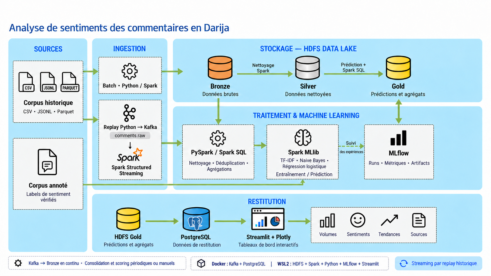

# LahjaLens

Plateforme de Big Data Analytics dédiée à l’analyse automatique des commentaires marocains en darija, arabe et français.



## Architecture

LahjaLens suit l’architecture de référence validée pour l’analyse de sentiments des commentaires en darija :

```text
Corpus historique ──┬──► Batch Python / Spark ──► HDFS Bronze
                    └──► Replay Python → Kafka ──► Spark Structured Streaming
                                                       │
HDFS Bronze ──► Nettoyage Spark ──► HDFS Silver ──► Spark SQL ──► HDFS Gold
                                       │                            │
Corpus annoté ──► Spark MLlib ────────┘                            │
                         │                                          │
                         └────────────► MLflow                      │
                                                                    ▼
                                                   PostgreSQL ──► Streamlit + Plotly
```

## Stack technique

- Python 3.11 et Parquet pour l’ingestion batch
- Hadoop HDFS 3.4.2 comme data lake
- PySpark 3.5.7 sur un cluster Docker composé d’un Master et de deux Workers
- Apache Kafka 3.9.x en mode KRaft pour le replay et le streaming
- Spark MLlib pour la classification de sentiment
- MLflow pour le suivi des expériences ML
- PostgreSQL pour la restitution analytique
- Streamlit et Plotly pour les KPI, tendances, thèmes et sources
- Docker Compose pour le cluster complet : Spark, HDFS, Kafka, PostgreSQL et MLflow

## Cours pour comprendre le projet

Le [cours technique et théorique LahjaLens](docs/COURS_LAHJALENS.md) explique les concepts du projet, du CSV au dashboard : Docker, HDFS, Kafka, Spark, NLP, labels, déséquilibre des classes, Machine Learning, MLflow et Git. Il comprend un parcours de lecture, des exemples, huit TP et dix exercices corrigés.

La préparation du corpus de sentiment est documentée dans le [pipeline AfriSenti](docs/datasets/AFRISENTI_PIPELINE.md). Hespress reste utilisé pour le contexte des articles et les thèmes ; AfriSenti fournit les labels `negative`, `neutral` et `positive` pour l'entraînement supervisé.

Le [diagnostic du sentiment du 15 novembre](docs/datasets/SENTIMENT_DIAGNOSTIC.md) explique le décalage entre les écritures arabe et latine, les corrections testées et leurs limites. Le [notebook 05](notebooks/05_sentiment_script_aware.ipynb) fournit la nouvelle baseline expérimentale ; son macro-F1 test est de 56,99 %, sans validation actuelle du transfert à Hespress.

## Organisation du développement

Le projet est construit progressivement, fichier par fichier. Chaque étape doit être vérifiée avant de poursuivre. Les données réelles, les données synthétiques de test et les résultats observés doivent rester explicitement distingués.

Le fichier maître attendu est `DARIJAPULSE_CODEX_MASTER_SPEC.md`. Il doit être placé à la racine du dépôt avant toute implémentation dépendant de contrats, chemins HDFS ou critères détaillés.

## Principes

- Utiliser le cluster Docker exigé par la fiche : Spark Master, deux Workers, NameNode et deux DataNodes HDFS.
- Respecter les contrats JSON et Parquet définis par la spécification.
- N’entraîner les modèles que sur des exemples avec des labels fiables.
- Utiliser Kafka pour le replay historique ou des événements issus d’une source autorisée.
- Conserver un corpus annoté séparé, avec des labels de sentiment vérifiés, pour l’entraînement.
- Ne jamais inventer de dataset, résultat, métrique ou service fonctionnel.
- Conserver un code Python 3.11 typé, modulaire, testable et compatible avec les ressources disponibles.

## État actuel

Le dépôt contient la documentation, l’infographie, la configuration du cluster Docker, les contrats d’événements et la préparation du corpus Hespress. Les notebooks de préparation et d'entraînement du sentiment AfriSenti ont été exécutés sur le cluster Spark, avec modèles et rapports enregistrés dans HDFS. L'intégration de cette baseline au pipeline de restitution et sa validation sur les commentaires Hespress restent à réaliser.

## Données Hespress : première étape

Les catégories politique, économie, société, sport et art et culture représentent **139 166 commentaires et 5 000 articles**. Les dix CSV originaux sont partagés dans `data/raw/hespress/v1/`, avec leur provenance et leurs empreintes SHA-256 (environ 91 Mo au total). Ils proviennent du [dataset Hespress de Tariq Massaoudi](https://www.kaggle.com/datasets/tariqmassaoudi/hespress), dont le déposant déclare une licence CC0. L’échantillon initial de 1 000 commentaires est également partagé dans `data/processed/hespress/comments_sample.csv`.

Après avoir récupéré la branche `feature/docker-compose`, les fichiers sont déjà disponibles. Pour vérifier leur intégrité et reproduire l’échantillon sans accès réseau, avec Python 3.11 ou plus récent :

```powershell
python scripts/prepare_hespress.py --audit-only
```

Pour récupérer les originaux depuis Kaggle si les fichiers n’ont pas encore été téléchargés :

```powershell
python scripts/prepare_hespress.py
```

Le sentiment et le thème à annoter restent vides ; la rubrique de l’article fournit une information de contexte. Les copies annotées de chaque membre et les autres sorties locales restent exclues de Git. Les originaux partagés doivent rester intacts ; les règles `.gitattributes` préservent leurs octets et leurs empreintes sur Windows et Linux.

Voir le [guide du premier TP](docs/datasets/HESPRESS_GUIDE.md), le [rapport d’audit](docs/datasets/HESPRESS_AUDIT.md) et le [choix des datasets](docs/datasets/DATASET_DECISION.md).

## Premier replay Kafka

Valider un lot équilibré de 100 commentaires sans connexion Kafka :

```powershell
python -m src.streaming.producer --dry-run --limit 100
```

Avec le client `kafka-python-ng` installé, Kafka démarré et le topic `comments.raw` créé :

```powershell
python -m src.streaming.producer --limit 100 --delay 0.2
```

Le producteur utilise l'échantillon préparé, conserve ses identifiants et compte uniquement les envois confirmés par le broker. Voir le [TP Kafka](docs/KAFKA_TP.md) pour les prérequis et le test dans deux terminaux.

## Data Warehouse et dashboard

Après l’inférence E2, le flux Gold peut être chargé dans PostgreSQL puis consulté
dans **LahjaLens Analytics** avec Streamlit et Plotly. Les commandes et les
contrats sont documentés dans [WAREHOUSE_DASHBOARD.md](docs/WAREHOUSE_DASHBOARD.md).

---

# Conventions de développement

## Mission du projet

LahjaLens est une plateforme de Data Engineering, Machine Learning, MLOps et Business Intelligence dédiée à l’analyse de commentaires marocains en darija, arabe et français.

L’architecture cible comprend :

- ingestion batch de données historiques en Python et Parquet ;
- événements réels ou explicitement rejoués via Kafka ;
- data lake HDFS organisé en couches Bronze, Silver et Gold ;
- traitements Apache Spark / PySpark, SQL et Structured Streaming ;
- classification de sentiment avec Spark MLlib ;
- suivi des expériences avec MLflow ;
- restitution PostgreSQL et tableau de bord Streamlit + Plotly.

## Règle de progression

Le développement se fait fichier par fichier, dans l’ordre défini par le cahier des charges maître.

À chaque étape :

1. créer ou modifier un seul fichier ;
2. expliquer brièvement les décisions importantes ;
3. fournir les commandes de vérification adaptées ;
4. exécuter les vérifications lorsque l’environnement le permet ;
5. attendre l’instruction explicite `suivant` avant de passer à l’étape suivante.

Ne pas créer de composant supplémentaire, de fichier de configuration ou de code auxiliaire sans demande explicite de l’étape en cours.

## Sources de vérité

- `DARIJAPULSE_CODEX_MASTER_SPEC.md` est la spécification technique de référence lorsqu’il est disponible à la racine du projet.
- En cas de contradiction, appliquer la spécification maître puis demander une clarification avant toute implémentation concernée.
- Ne jamais inventer un dataset, un label, un résultat de test, une métrique, un service fonctionnel ou une donnée métier.
- Distinguer clairement les données réelles, les exemples de documentation et les données synthétiques de test.

## Environnement cible

- Python 3.11 ;
- Java 11 ;
- Hadoop HDFS 3.4.2 dans Docker avec deux DataNodes ;
- PySpark 3.5.7 exécuté par le cluster Spark ;
- Apache Kafka 3.9.x en mode KRaft ;
- MLflow ;
- PostgreSQL ;
- Streamlit et Plotly ;
- Docker Compose pour le cluster complet et ses services complémentaires.

Le cluster HDFS de démonstration est celui défini dans `docker-compose.yml`. Respecter les ressources disponibles : Core Ultra 7, 32 Go de RAM et RTX 5070 avec 8 Go de VRAM. Le GPU est réservé aux extensions Transformer et ne doit pas être rendu obligatoire pour le MVP Spark MLlib. Les traitements Spark présentés doivent utiliser `spark://spark-master:7077`; `local[*]` est réservé aux tests rapides.

## Conventions de code

- Écrire du Python compatible avec Python 3.11.
- Préférer un code typé, modulaire, lisible et testable.
- Utiliser des noms explicites et cohérents avec les contrats de données.
- Garder les fonctions courtes et limiter les effets de bord.
- Valider les entrées et produire des erreurs explicites et exploitables.
- Ne pas masquer une erreur par un `except` trop général ou un résultat de remplacement silencieux.
- Éviter les chemins absolus propres à une machine ; centraliser les chemins et paramètres prévus par la spécification.
- Ne pas inscrire de secrets, mots de passe, tokens ou identifiants dans le dépôt.
- Préserver l’encodage UTF-8 pour les textes en darija, arabe et français.

## Données et contrats

- Respecter strictement les schémas JSON et Parquet définis par la spécification maître.
- Conserver la traçabilité de la source, du temps d’ingestion et de l’identifiant d’événement lorsque le contrat le prévoit.
- Ne jamais entraîner un modèle sur des exemples dont les labels ne sont pas fiables ou explicitement documentés.
- Le dataset MSDA peut servir à la classification à trois sentiments si sa structure et ses labels sont vérifiés.
- AtlasIA est réservé, à ce stade, à une éventuelle tâche distincte de détection de la darija.
- Séparer les couches Bronze, Silver et Gold ; ne pas mélanger données brutes et données transformées.
- Les événements Kafka doivent provenir d’une source autorisée ou d’un replay explicitement documenté.

## HDFS, Spark et Kafka

- Utiliser les chemins HDFS définis par la spécification, sans les deviner.
- Vérifier les lectures et écritures réelles avant de déclarer une étape terminée.
- Utiliser le connecteur officiel `spark-sql-kafka-0-10_2.12` pour l’intégration Kafka avec Spark.
- Documenter les prérequis locaux lorsqu’une vérification nécessite HDFS, Kafka, PostgreSQL ou MLflow.
- Ne pas présenter un service comme disponible si son état n’a pas été vérifié.

## Machine Learning et MLOps

- Séparer nettoyage, préparation, entraînement, évaluation et inférence.
- Éviter les fuites de données entre entraînement et évaluation.
- Rapporter les métriques réellement calculées et leur jeu de données de référence.
- Enregistrer dans MLflow uniquement les paramètres, métriques et artefacts effectivement produits.
- Rendre les expériences reproductibles autant que possible avec des graines et une configuration explicites.

## Tests et validation

- Commencer par les vérifications les plus ciblées pour le fichier de l’étape.
- Tester les cas nominaux, les entrées invalides et les cas limites pertinents.
- Pour les composants dépendant d’un service externe, distinguer les tests unitaires des tests d’intégration.
- Ne jamais transformer une absence de service ou de dataset en succès simulé.
- Indiquer la commande exécutée, le résultat observé et toute limite de validation.

## Communication des changements

Pour chaque étape terminée, fournir :

- le fichier créé ou modifié ;
- un résumé concis de son rôle ;
- les hypothèses prises et les limites connues ;
- les commandes de test exécutées et leurs résultats ;
- les prérequis éventuels pour la validation suivante.

Ne pas avancer automatiquement vers le fichier suivant. L’utilisateur doit examiner le résultat et envoyer `suivant`.

## État initial

Le fichier `MASTER_SPEC.md` doit être placé à la racine du projet avant toute étape qui dépend de contrats, chemins ou critères non reproduits dans ce document. Tant qu’il est absent, demander sa mise à disposition lorsqu’une décision ne peut pas être prise de manière fiable.
