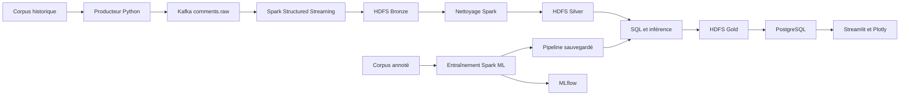

# Cours technique et théorique LahjaLens

Ce cours explique comment construire et comprendre une plateforme d'analyse de commentaires marocains. Il part d'un commentaire dans un fichier et suit son parcours jusqu'aux indicateurs d'un tableau de bord. Il s'adresse à une équipe qui découvre Kafka, Spark, HDFS et le Machine Learning.

L'objectif est de pouvoir expliquer le rôle de chaque composant, lire le code du projet, vérifier une expérience et reconnaître un résultat trompeur. Les exemples de commentaires et les calculs d'exercices sont pédagogiques. Les commandes des TP sont à exécuter manuellement depuis la racine du dépôt, dans PowerShell, après lecture de leurs prérequis.

L'environnement de référence comprend Spark 3.5.7, Kafka 3.9.1, HDFS 3.4.2, PostgreSQL 16 et MLflow 2.10.2. Docker héberge un Master Spark, deux Workers, un NameNode et deux DataNodes. Python 3.11 est la version cible du code du projet ; la version réellement présente dans les images doit être vérifiée.

## Parcours de lecture

| Séance | Chapitres | Objectif |
|---|---|---|
| 1 | 1 à 4 | Comprendre les données et leur qualité |
| 2 | 5 et 6 | Comprendre Docker et le stockage distribué |
| 3 | 7 à 9 | Comprendre Kafka et Spark |
| 4 | 10 à 12 | Passer des textes aux analyses NLP |
| 5 | 13 à 15 | Préparer et évaluer le Machine Learning |
| 6 | 16 à 18 | Suivre les modèles et travailler en équipe |
| 7 | 19 et 20 | Faire les TP et les exercices |
| 8 | 21 et 22 | Réviser et préparer la démonstration |

Sommaire :

1. [Comprendre le projet](#1-comprendre-le-projet)
2. [Lire une architecture de données](#2-lire-une-architecture-de-données)
3. [Comprendre les formats et les contrats](#3-comprendre-les-formats-et-les-contrats)
4. [Auditer et reproduire les données](#4-auditer-et-reproduire-les-données)
5. [Comprendre Docker et les adresses réseau](#5-comprendre-docker-et-les-adresses-réseau)
6. [Comprendre HDFS et le Data Lake](#6-comprendre-hdfs-et-le-data-lake)
7. [Comprendre Kafka](#7-comprendre-kafka)
8. [Comprendre Spark et PySpark](#8-comprendre-spark-et-pyspark)
9. [Comprendre Structured Streaming](#9-comprendre-structured-streaming)
10. [Construire Silver et Gold](#10-construire-silver-et-gold)
11. [Comprendre le NLP en darija](#11-comprendre-le-nlp-en-darija)
12. [Distinguer sentiments thèmes et tendances](#12-distinguer-sentiments-thèmes-et-tendances)
13. [Construire les labels et traiter le déséquilibre](#13-construire-les-labels-et-traiter-le-déséquilibre)
14. [Transformer le texte en nombres](#14-transformer-le-texte-en-nombres)
15. [Entraîner et évaluer les modèles](#15-entraîner-et-évaluer-les-modèles)
16. [Suivre les expériences avec MLflow](#16-suivre-les-expériences-avec-mlflow)
17. [Restituer avec PostgreSQL et Streamlit](#17-restituer-avec-postgresql-et-streamlit)
18. [Collaborer avec Git et diagnostiquer](#18-collaborer-avec-git-et-diagnostiquer)
19. [Réaliser les TP](#19-réaliser-les-tp)
20. [Exercices et corrigés](#20-exercices-et-corrigés)
21. [Glossaire](#21-glossaire)
22. [Préparer la démonstration](#22-préparer-la-démonstration)

## 1 Comprendre le projet

### Le problème métier

Une plateforme reçoit des commentaires comme « had service zwin » ou « الثمن غالي بزاف ». On souhaite déterminer les opinions exprimées, les sujets abordés et les sujets les plus présents dans le corpus.

Une analyse exploitable doit répondre à une question précise. « Combien de commentaires concernent le sport ? » demande une catégorie. « Leurs auteurs sont-ils satisfaits ? » demande une cible de sentiment. « Le sujet devient-il plus fréquent ? » demande des dates fiables et une comparaison entre périodes.

### Les disciplines réunies

| Discipline | Question principale | Application dans LahjaLens |
|---|---|---|
| Data Engineering | Comment transporter et stocker les données ? | Ingestion, Kafka, HDFS, Spark |
| Analyse de données | Que contient le corpus ? | Volumes, langues, rubriques, qualité |
| NLP | Comment représenter et interpréter les textes ? | Nettoyage, tokenisation, thèmes |
| Machine Learning | Comment apprendre une règle depuis des exemples ? | Classification du sentiment |
| MLOps | Comment reproduire et suivre les modèles ? | Versions, expériences, MLflow |
| Business Intelligence | Comment rendre les résultats lisibles ? | PostgreSQL, Streamlit, Plotly |

Un projet peut être correct techniquement et répondre à la mauvaise question. Par exemple, un modèle entraîné à prédire les votes ne devient pas automatiquement un modèle de sentiment.

### La notion de Big Data

Le volume compte, mais aussi la vitesse d'arrivée, la variété des formats et la qualité. Un fichier de quelques dizaines de mégaoctets peut être traité sur un seul ordinateur. Ici, le cluster sert à apprendre et à démontrer une architecture distribuée imposée par le projet.

Les conteneurs partagent toutefois le même PC : ils simulent plusieurs nœuds logiques. Une panne de cette machine peut arrêter tout le cluster.

**Question de compréhension :** quel résultat métier serait faux si tous les programmes fonctionnaient, mais si les labels de sentiment étaient incorrects ?

## 2 Lire une architecture de données

Le schéma représente le fonctionnement cible ; la présence de chaque job doit être vérifiée sur la branche utilisée.



### Batch et streaming

Le **batch** traite un ensemble borné : par exemple, tous les commentaires d'un fichier. Le **streaming** traite les messages disponibles au fil de leur arrivée.

Un **replay** lit un corpus historique et envoie ses lignes progressivement. L'arrivée est nouvelle pour Kafka, mais le commentaire reste historique. Cette technique permet d'apprendre le streaming avec des fichiers déjà disponibles.

Dans notre architecture, Kafka conserve un journal de messages, Spark effectue les calculs et HDFS organise l'historique. Ces fonctions complémentaires permettent de relire et recalculer les analyses.

### ETL et ELT

**ETL** signifie extraire, transformer, puis charger. **ELT** signifie extraire, charger, puis transformer. Charger une version brute dans Bronze avant le nettoyage se rapproche d'ELT : on garde une trace des données reçues pour pouvoir corriger les traitements ultérieurement.

**Mini-exercice :** dessiner le parcours d'un commentaire, puis entourer les composants qui stockent une information et souligner ceux qui calculent.

## 3 Comprendre les formats et les contrats

### CSV JSON JSONL et Parquet

| Format | Organisation | Usage dans le projet |
|---|---|---|
| CSV | Tableau textuel avec séparateur et guillemets | Sources et échantillons annotables |
| JSON | Objet avec champs nommés | Événement Kafka |
| JSONL | Un objet JSON par ligne | Journaux ou exports structurés |
| Parquet | Format binaire organisé par colonnes | Historique analytique dans HDFS |

Un CSV n'est pas toujours une ligne physique par commentaire : un champ entre guillemets peut contenir des sauts de ligne. Compter les lignes avec un éditeur peut donc donner un faux nombre d'enregistrements. Il faut utiliser un parseur CSV.

UTF-8 conserve les caractères arabes, français et les emojis. L'encodage doit rester cohérent entre fichier, sérialisation Kafka, programme et terminal.

Parquet permet de conserver des types et de lire certaines colonnes sans charger toutes les autres. Il convient aux calculs Spark ; on ne le modifie pas avec un éditeur de texte.

### Un contrat est une interface commune

Le producteur et le consommateur doivent s'accorder sur les noms, les types, les champs obligatoires et les valeurs autorisées. Le contrat local est implémenté dans [events.py](../src/schemas/events.py).

Événement pédagogique conforme à sa structure :

```json
{
  "event_id": "tp:commentaire:001",
  "comment_text": "had service zwin",
  "source": "exercice",
  "language": "darija",
  "event_time": null,
  "ingestion_time": "2026-11-11T10:00:00Z",
  "article_id": "tp:article:001",
  "article_title": "Un service de transport",
  "article_topic": "societe",
  "article_date_raw": null,
  "article_published_at": null,
  "replay_time": "2026-11-11T10:00:01Z"
}
```

`event_id` identifie le commentaire de façon stable. Le texte constitue la donnée à analyser. Le contexte de l'article aide à comprendre la provenance. Un résultat de sentiment prédit sera enregistré séparément.

### Comprendre les différentes dates

| Champ | Question à laquelle il répond |
|---|---|
| `event_time` | Quand le commentaire a-t-il été publié ? |
| `article_published_at` | Quand l'article a-t-il été publié ? |
| `ingestion_time` | Quand le commentaire est-il entré dans la plateforme ? |
| `replay_time` | Quand a-t-il été rejoué vers Kafka ? |

`null` signifie que la date est inconnue ou non applicable. `Z` indique UTC. La date d'article ne remplace pas celle du commentaire. Un texte d'article contenant une date arabe doit être conservé dans `article_date_raw` jusqu'à une conversion fiable.

### Versionner un contrat

Ajouter un champ facultatif peut conserver la compatibilité. Renommer un champ obligatoire ou rendre `replay_time` obligatoire peut casser les programmes existants. Une évolution doit donc être revue et testée avec les deux côtés de l'interface.

**Mini-exercice :** expliquer pourquoi un consommateur doit conserver `article_topic`, même s'il ne calcule pas encore de thèmes.

## 4 Auditer et reproduire les données

### La provenance

Pour chaque corpus, conserver l'URL, la version, la date de récupération, les conditions d'utilisation, le schéma, les volumes et les empreintes des fichiers. Une empreinte **SHA-256** aide à vérifier que deux membres possèdent les mêmes octets ; elle ne certifie pas la qualité des annotations.

Les originaux Hespress restent dans `data/raw/hespress/v1/`. Le manifeste et le [rapport d'audit](datasets/HESPRESS_AUDIT.md) documentent cette version.

### La jointure commentaire article

Une **clé** relie deux tables. Dans Hespress, `postId` du commentaire correspond à `id` de l'article. Une jointure permet de récupérer le titre et la rubrique.

Le champ `source_record` de l'échantillon représente un numéro d'enregistrement CSV commençant à 1. La colonne d'index du fichier source constitue une autre information. Utiliser l'un à la place de l'autre peut rattacher un vote au mauvais commentaire.

### Les contrôles de qualité

Vérifier au minimum : schéma attendu, types, champs vides, valeurs autorisées, identifiants uniques, textes répétés, correspondances vers les articles et distribution des catégories.

Deux identifiants différents peuvent contenir le même texte. Un même texte peut aussi porter des labels contradictoires. On doit distinguer ces cas avant de supprimer des lignes.

### Reproduire un échantillon

Une graine aléatoire, par exemple `seed=42`, rend une sélection reproductible si les données, l'ordre d'entrée et l'algorithme restent identiques. La graine seule ne suffit pas.

Une **sélection stratifiée** prélève des observations dans chaque groupe. Nos 1 000 commentaires Hespress contiennent 200 éléments par rubrique. Cela équilibre les rubriques de cet échantillon, pas les sentiments, qui restent à annoter.

Pour revoir les décisions de données : [choix des datasets](datasets/DATASET_DECISION.md) et [guide Hespress](datasets/HESPRESS_GUIDE.md).

## 5 Comprendre Docker et les adresses réseau

### Image conteneur service et volume

Une **image** contient les fichiers nécessaires à un environnement. Un **conteneur** est une instance en exécution. Dans Compose, un **service** décrit comment lancer ce conteneur : image, commande, variables, ports et stockage.

Compose décrit les services dans `docker-compose.yml`. Le partage de ce fichier permet de reproduire la topologie sur les machines de l'équipe. Voir [les principes de Compose](https://docs.docker.com/compose/intro/features-uses/).

Un **volume nommé** conserve les données indépendamment du remplacement d'un conteneur. Un **bind mount** rend accessible un dossier du PC dans un conteneur. Exemple du dépôt : `./data:/opt/lahjalens/data`.

Le chemin réellement utilisé par l'application doit correspondre au chemin monté. Pour Kafka, monter `/var/lib/kafka/data` ne suffit pas si le broker écrit ses journaux ailleurs : `KAFKA_LOG_DIRS` doit désigner ce dossier. Voir [les volumes Docker](https://docs.docker.com/engine/storage/volumes/).

### Comprendre les ports

La déclaration `5434:5432` signifie : port 5434 du PC vers port 5432 du conteneur. Le programme lancé sur Windows et celui lancé dans Docker utilisent donc des adresses différentes.

| Service | Depuis le PC | Depuis le réseau Compose |
|---|---|---|
| Kafka | `localhost:9092` | `kafka:29092` |
| Spark Master | `spark://localhost:7077` | `spark://spark-master:7077` |
| HDFS NameNode | RPC publié sur `localhost:9000` | `hdfs://namenode:9000` |
| PostgreSQL | `localhost:5434` | `postgres:5432` |
| MLflow | `http://localhost:5000` | `http://mlflow:5000` |

Pour HDFS, joindre le NameNode depuis le PC ne garantit pas l'accès aux blocs : le client doit aussi joindre les DataNodes. Les jobs du projet sont donc lancés dans Docker avec les adresses internes.

`localhost` désigne l'environnement courant. Dans Spark Worker 1, il désigne Spark Worker 1. Le nom `kafka` est résolu entre les services du réseau Compose. Voir [le réseau Docker](https://docs.docker.com/engine/network/).

### Variables et dépendances

Une variable d'environnement configure un programme sans modifier son code. Un fichier `.env` ne devient pas automatiquement l'environnement de chaque conteneur ni celui de chaque script Python : il faut un mécanisme explicite de chargement ou de transmission.

De même, installer `requirements.txt` sur Windows n'installe pas ces bibliothèques dans les images Spark. Driver et executors doivent disposer des dépendances et d'interpréteurs compatibles.

**Mini-exercice :** quelle adresse PostgreSQL utilise un dashboard lancé dans Docker ? Pourquoi `localhost:5434` y serait-il incorrect ?

## 6 Comprendre HDFS et le Data Lake

### Le stockage distribué

HDFS répartit les blocs des fichiers sur plusieurs DataNodes. Le **NameNode** connaît les chemins, les blocs et leurs emplacements. Les **DataNodes** conservent les blocs ; le client les contacte pour les lire et les écrire.

Dans LahjaLens, un NameNode et deux DataNodes s'exécutent dans des conteneurs distincts. Le facteur de réplication demandé est 2 : chaque bloc doit avoir deux copies, réparties sur les deux DataNodes disponibles. L'espace physique nécessaire est approximativement doublé, hors compression et métadonnées. Voir [l'architecture HDFS](https://hadoop.apache.org/docs/r3.4.2/hadoop-project-dist/hadoop-hdfs/HdfsDesign.html).

La réplication n'est pas une sauvegarde historique : une suppression logique peut supprimer toutes les copies du fichier. Le NameNode unique reste également un point de panne ; nous ne déployons pas de haute disponibilité du NameNode dans ce TP.

### Les couches Bronze Silver Gold

| Couche | Contenu | Exemple |
|---|---|---|
| Bronze | Données reçues avec leur traçabilité | JSON Kafka brut, clé, topic, partition, offset |
| Silver | Données validées, nettoyées et dédupliquées | Commentaire unique avec contexte conservé |
| Gold | Données prêtes pour une analyse | Volumes par rubrique et sentiments prédits |

Ces couches sont une convention d'organisation. HDFS ne crée pas automatiquement une couche Silver ou un modèle Gold.

Bronze permet de revenir à la donnée reçue. Silver porte les règles de transformation. Gold sert les indicateurs. Les chemins usuels du projet commencent par `/data/lahjalens/bronze`, `/data/lahjalens/silver` et `/data/lahjalens/gold`.

### Partitionner les fichiers

Un dossier comme `source=hespress/ingestion_date=2026-11-11/` permet de cibler des données à la lecture. Choisir une date d'ingestion comme partition physique ne transforme pas cette date en date de commentaire.

Des milliers de très petits fichiers rendent les lectures moins efficaces. On préfère consolider périodiquement les micro-lots en fichiers Parquet de taille adaptée.

### Vérifier la réplication réelle

Lire une configuration ne prouve pas que les blocs possèdent deux copies. Il faut vérifier les DataNodes actifs, l'état des blocs et le résultat d'un fichier effectivement écrit. Les clients Spark doivent eux aussi demander une réplication cohérente, par configuration Hadoop ou `spark.hadoop.dfs.replication=2`.

Voir [le guide utilisateur HDFS](https://hadoop.apache.org/docs/r3.4.2/hadoop-project-dist/hadoop-hdfs/HdfsUserGuide.html) pour les contrôles de stockage.

## 7 Comprendre Kafka

### Un journal de messages

Un **producer** envoie des événements. Un **broker** les stocke. Un **consumer** les lit. Un **topic** donne un nom au flux, par exemple `comments.raw`.

Chaque topic comporte des **partitions**, qui sont des journaux ordonnés. Un message a une position appelée **offset**, valable dans sa partition. L'identité technique de sa position est donc le triplet `(topic, partition, offset)`.

```text
comments.raw / partition 0
offset 0 : commentaire A
offset 1 : commentaire B
offset 2 : commentaire C
```

Un événement peut porter une **clé**, ici `event_id`, et une **valeur**, ici le JSON sérialisé en UTF-8. Une clé stable n'empêche pas un second envoi du même commentaire.

### Pourquoi Kafka dans ce projet

Kafka sépare l'envoi de la consommation, conserve temporairement les messages et permet leur relecture selon la rétention configurée. Il sert à démontrer un replay historique et l'alimentation du traitement Spark.

### Partitions et groupes

Les membres d'un même **consumer group** se partagent les partitions. Une partition est affectée à un seul consommateur de ce groupe à un instant donné. Des groupes différents peuvent lire indépendamment les mêmes messages.

Le topic de développement possède une partition : ajouter des consommateurs dans un même groupe n'augmente donc pas indéfiniment le parallélisme de sa lecture. Cela ne signifie pas qu'une application Spark ne peut jamais paralléliser les calculs en aval.

### Confirmation et doublons

Une confirmation du broker prouve un envoi accepté selon les garanties demandées. Avec un broker et une réplication Kafka de 1, `acks=all` ne crée pas une seconde copie sur un autre broker.

Un délai dépassé peut laisser un doute : le broker a peut-être reçu le message avant la perte de la réponse. Les réessais et les replays exigent donc une stratégie de déduplication ou d'idempotence dans le pipeline.

Le cluster utilise **KRaft** pour les métadonnées Kafka. Son contrôleur et son broker sont ici réunis dans le même service.

Pour les notions générales : [documentation Kafka](https://kafka.apache.org/39/documentation/). Pour le projet : [TP Kafka](KAFKA_TP.md).

### Les adresses annoncées

`listeners` définit les points d'écoute. `advertised.listeners` définit les adresses communiquées aux clients dans les métadonnées. Même si une première connexion réussit, une adresse annoncée inaccessible peut empêcher les échanges suivants.

Dans notre configuration : `EXTERNAL` annonce `localhost:9092` et `INTERNAL` annonce `kafka:29092`. Ces noms désignent les accès ; le protocole utilisé ici est `PLAINTEXT`. Voir [la configuration des brokers Kafka 3.9](https://kafka.apache.org/39/generated/kafka_config.html).

**Mini-exercice :** si le même `event_id` est envoyé deux fois, les offsets seront-ils nécessairement identiques ?

## 8 Comprendre Spark et PySpark

### Master Driver Worker Executor

Le **Driver** exécute le programme qui construit et coordonne le calcul. Le **Master**, dans notre cluster Standalone, attribue les ressources. Les **Workers** hébergent les processus **Executors** qui exécutent les tâches.

Le Master ne calcule pas toutes les transformations. Une application comporte un Driver et des Executors. Voir [l'organisation d'un cluster Spark](https://spark.apache.org/docs/3.5.7/cluster-overview.html).

| Terme | Signification |
|---|---|
| Application | Exécution complète d'un programme Spark |
| Job | Travail déclenché par une action |
| Stage | Partie du calcul séparée notamment par les échanges de données |
| Task | Travail effectué sur une partition de calcul |
| Executor | Processus qui exécute les tâches et peut conserver du cache |

### Les DataFrames

Un DataFrame Spark est une table distribuée avec un schéma. PySpark permet de décrire ses transformations en Python, tandis que le moteur Spark planifie leur exécution.

Fragment pédagogique, après création d'une session `spark` :

```python
from pyspark.sql import functions as F

comments = spark.read.parquet(
    "hdfs://namenode:9000/data/lahjalens/silver/comments/deduplicated"
)
counts = comments.groupBy("article_topic").agg(
    F.count("*").alias("total_comments")
)
counts.show()
```

Ce fragment suppose que Silver contient `article_topic`. Une colonne perdue lors de l'ingestion ne réapparaît pas au moment de l'agrégation.

### Évaluation paresseuse et shuffle

`select`, `filter` et `withColumn` décrivent des transformations. Une action comme `count`, `show` ou une écriture déclenche leur exécution. Répéter plusieurs actions peut recalculer un même plan ; le cache peut être utile si les données sont réutilisées et si les ressources le permettent.

Un **shuffle** échange des données entre Executors, par exemple pour regrouper toutes les lignes d'une même clé. Il utilise du réseau et de la mémoire. Une clé très fréquente peut créer une partition plus lourde que les autres : c'est le **skew**.

### Lancer réellement sur le cluster

Le paramètre `--master spark://spark-master:7077` sélectionne le cluster. Le mode de déploiement `client` garde le Driver dans le processus qui soumet l'application ; les calculs restent distribués dans les Executors.

Pour PySpark sur notre Standalone, on utilise ce mode client depuis un conteneur du réseau Compose. `client` ne signifie donc pas `local[*]`. Voir [la soumission d'applications Spark](https://spark.apache.org/docs/3.5.7/submitting-applications.html).

**Mini-exercice :** quelle différence existe entre une partition Kafka, une partition DataFrame et un dossier Parquet partitionné ?

## 9 Comprendre Structured Streaming

### Le fonctionnement par micro lots

Structured Streaming traite un DataFrame qui évolue. Le mode courant exécute des micro-lots. Un déclenchement toutes les dix secondes invite le moteur à traiter les nouvelles données à ce rythme lorsque la durée des traitements le permet ; il ne garantit pas un délai métier maximal de dix secondes.

Le **checkpoint** conserve l'avancement et, selon le traitement, l'état nécessaire à la reprise. Il doit utiliser un chemin persistant réservé à la requête. On ne partage pas ce chemin entre deux jobs différents. Voir [Structured Streaming et la reprise](https://spark.apache.org/docs/3.5.7/structured-streaming-programming-guide.html).

### Lire Kafka

Fragment pédagogique, après création de `spark` et ajout du connecteur Kafka correspondant à Spark 3.5.7 :

```python
from pyspark.sql import functions as F

raw = (
    spark.readStream.format("kafka")
    .option("kafka.bootstrap.servers", "kafka:29092")
    .option("subscribe", "comments.raw")
    .option("startingOffsets", "earliest")
    .load()
)
bronze = raw.select(
    F.col("key").cast("string").alias("kafka_key"),
    F.col("value").cast("string").alias("raw_json"),
    "topic", "partition", "offset",
    F.col("timestamp").alias("kafka_timestamp"),
)
```

La date Kafka n'est pas automatiquement la date historique du commentaire. Le JSON original et les métadonnées permettent de retrouver un message même si sa validation métier échoue.

Sur une nouvelle requête, `startingOffsets` définit le point de départ. Une reprise avec un checkpoint existant utilise la progression sauvegardée. Structured Streaming suit ses offsets dans son checkpoint ; l'avancement d'un consommateur console constitue une lecture indépendante. Voir [le connecteur Spark Kafka](https://spark.apache.org/docs/3.5.7/structured-streaming-kafka-integration.html).

### Fiabilité et idempotence

Une écriture est **idempotente** si rejouer la même opération produit le même état final. Un checkpoint seul ne rend pas toute écriture externe idempotente. Pour un sink personnalisé, il faut prévoir les réessais et la gestion des doublons.

Exemple : réexécuter un lot qui insère aveuglément ses 100 lignes SQL peut doubler le résultat. Une clé unique et une opération d'upsert peuvent éviter ces doublons logiques.

### Dates et fenêtres

Une fenêtre temporelle regroupe des événements sur un intervalle. Un watermark aide certains calculs avec état à gérer le retard des événements. Il ne peut pas reconstruire une date absente du corpus.

Pour Hespress, une fenêtre sur `replay_time` mesure le replay technique. Les tendances historiques des commentaires exigent des `event_time` fiables.

## 10 Construire Silver et Gold

### Nettoyer en conservant la trace

Silver peut contenir le texte source et un texte nettoyé distinct. Les règles doivent être explicites : espaces, encodage, balises, champs obligatoires et identifiants.

Une déduplication par `event_id` traite les replays du même commentaire. Une déduplication textuelle traite les textes identiques. Elle peut retirer des occurrences légitimes si plusieurs personnes publient la même phrase ; la règle dépend donc de l'usage.

Si plusieurs versions d'un commentaire existent, choisir un ordre fiable et un départage déterministe. Retenir simplement une ligne au hasard peut produire des résultats variables.

### Calculer des indicateurs

Après enregistrement du DataFrame Silver en vue temporaire `silver_comments`, une requête pédagogique est :

```sql
SELECT article_topic, COUNT(*) AS total_comments
FROM silver_comments
GROUP BY article_topic
ORDER BY total_comments DESC;
```

Cette requête mesure les rubriques des articles associés. Elle ne constitue pas une classification des thèmes propres aux commentaires.

Le taux de commentaires négatifs doit préciser son dénominateur : tous les commentaires, les commentaires valides ou seulement ceux pour lesquels le modèle a émis une prédiction.

### Nommer correctement les dates

Une colonne `replay_date` peut être calculée depuis `replay_time`. Une colonne `comment_date` doit rester fondée sur `event_time`. Les valeurs inconnues peuvent être comptées et affichées séparément.

Une expression qui remplace systématiquement `event_time` par `replay_time` produit une mesure du traitement sous un nom de mesure sociale. La requête doit expliciter cette différence.

Spark SQL et les transformations DataFrame utilisent le même moteur structuré. Voir [le guide Spark SQL](https://spark.apache.org/docs/3.5.7/sql-programming-guide.html).

## 11 Comprendre le NLP en darija

### Le langage comme donnée

Le NLP, ou traitement automatique des langues, transforme des textes pour permettre des recherches, classifications ou regroupements. Les difficultés de la darija comprennent les variantes orthographiques, l'alphabet arabe, l'Arabizi, le mélange avec le français et les expressions dépendantes du contexte.

Les expressions « زوين », « zwin » et « zwine » peuvent représenter une idée proche avec des graphies différentes. Un modèle basé sur des mots distincts ne les rapproche pas nécessairement.

### Nettoyer sans retirer le sens

La normalisation peut harmoniser les espaces et certains caractères. La tokenisation découpe le texte en unités. Le traitement doit toutefois préserver les informations utiles à la tâche.

Par exemple, retirer « pas » dans « pas satisfait » inverse potentiellement l'information. Les constructions de négation en darija, les emojis et les répétitions peuvent porter du sentiment. Réduire toutes les répétitions à une lettre ou supprimer toute ponctuation doit être évalué, pas appliqué automatiquement.

On conserve le texte original et une version transformée. Les règles de nettoyage doivent être communes à l'entraînement et à la prédiction.

### Détecter la langue

L'alphabet arabe ne suffit pas à distinguer l'arabe standard de la darija. Une règle par mots-clés constitue une heuristique, avec des erreurs possibles. Une langue inférée doit être distinguée d'une annotation humaine.

Un système utile conserve la possibilité de répondre `inconnu` ou `mixte`. Afficher une distribution linguistique estimée ne prouve pas que chaque commentaire a été correctement classé.

**Mini-exercice :** expliquer ce qu'un nettoyeur trop agressif peut retirer dans « ma3jbnich had service 😡 ».

## 12 Distinguer sentiments thèmes et tendances

### Des tâches différentes

| Tâche | Question | Exemple pédagogique |
|---|---|---|
| Sentiment | Quelle polarité envers une cible ? | Négatif envers le prix du transport |
| Thème | De quoi parle le commentaire ? | Transport, prix, services publics |
| Émotion | Quelle émotion est exprimée ? | Colère ou déception |
| Langue | Quelle variété est utilisée ? | Darija en alphabet latin |
| Contenu offensant | Le texte comporte-t-il une attaque ? | Étiquette distincte du sentiment |
| Tendance | Comment la fréquence évolue-t-elle ? | Hausse du sujet transport sur une période |

Un commentaire critique peut être respectueux. Un commentaire positif peut contenir un mot vulgaire. Les labels d'offense et de sentiment répondent donc à des questions différentes.

### La cible du sentiment

« Le prix est trop élevé mais le service est excellent » exprime deux opinions envers deux aspects. Une classification globale en trois classes exige une règle d'annotation pour ces cas. Une analyse par aspect est une extension plus fine, qui demande des données adaptées.

Le mot `mixed` d'un corpus peut indiquer des opinions opposées. Le transformer en `neutral` fusionnerait deux significations différentes.

### Classification et découverte de thèmes

Pour une classification supervisée, on définit des thèmes et annote des exemples. Pour une découverte de thèmes, on regroupe les textes selon leurs ressemblances, puis on interprète et évalue les groupes. Un numéro de cluster n'est pas automatiquement une catégorie comme « politique ».

Les rubriques Hespress sont un contexte d'article. Les utiliser pour prédire la rubrique constitue une tâche distincte de la reconnaissance du sujet exact du commentaire.

Une classification **multiclasse** choisit une classe parmi plusieurs. Une classification **multilabel** peut attribuer plusieurs thèmes compatibles à un même texte. Une approche **multitâche** prédit des dimensions différentes, par exemple sentiment et langue.

### Mesurer une tendance

Compter les sujets les plus fréquents mesure une présence dans le corpus. Mesurer leur évolution exige des dates et des fenêtres comparables.

Une définition possible, choisie pour un futur indicateur, est :

```text
part_du_theme = commentaires_du_theme / commentaires_observes_dans_la_periode
variation = part_du_theme_periode_courante - part_du_theme_periode_precedente
```

La différence est exprimée en points de proportion. Il faut aussi afficher les volumes : passer d'une observation à deux ne donne pas la même solidité que passer de mille à deux mille.

Des commentaires rejoués aujourd'hui ne prouvent pas une tendance actuelle sur Facebook ou Instagram. Ces plateformes exigent des données récentes, une provenance identifiable et des dates pertinentes pour cette mesure.

## 13 Construire les labels et traiter le déséquilibre

### Features et cible

Une **feature** est une variable disponible pour prédire : par exemple les mots du texte. La **cible**, ou label, est ce qu'on cherche à prédire : ici `negative`, `neutral` ou `positive`.

Un vote de lecteur mesure une réaction au commentaire. Un texte négatif envers un service peut recevoir beaucoup de votes positifs. Le signe du score de votes ne constitue donc pas le label de sentiment recherché.

### Annoter un corpus

L'équipe doit définir la cible de l'opinion et les règles pour les textes neutres, ambigus, ironiques ou mixtes. Deux membres annotent indépendamment un lot commun ; le troisième aide à résoudre les désaccords.

Conserver l'identifiant, le label, l'annotateur, la version du guide et, si nécessaire, un statut `a_revoir`. Une prédiction automatique préremplie doit être identifiée comme telle pour éviter de la confondre avec une vérité humaine.

### Choisir les corpus selon leur rôle

| Corpus étudié | Rôle possible | Point d'attention |
|---|---|---|
| Hespress | Ingestion, contexte d'article, évaluation sur les commentaires | Votes distincts du sentiment ; date de commentaire absente |
| AfriSenti `ary` | Apprentissage du sentiment marocain sur des tweets | Nettoyer les doublons et préserver les séparations des ensembles |
| MDMD | Sentiment et autres annotations sur des commentaires Facebook | Filtrer les langues selon le périmètre ; clarifier la licence de réutilisation |
| Darija Reviews | Évaluation complémentaire avec sentiments et thèmes de consommation | Petit corpus ; normaliser les libellés |

Les versions examinées doivent être figées avant une expérience. Les sources décrivent des domaines différents : les performances sur des tweets ne garantissent pas les mêmes résultats sur des commentaires de presse.

Pour la provenance : [AfriSenti](https://github.com/afrisenti-semeval/afrisent-semeval-2023), [MDMD](https://github.com/otman-gi/MDMD) et [Darija Reviews](https://huggingface.co/datasets/ohidaoui/darija-reviews).

### Comprendre le déséquilibre

Dans un exemple fictif de 1 000 textes, supposons 800 positifs, 100 négatifs et 100 neutres. Un programme qui répond toujours « positif » atteint 80 % d'accuracy, bien qu'il ne reconnaisse aucune des deux autres classes.

L'équilibre des thèmes n'implique pas celui des sentiments. Les 200 commentaires de chaque rubrique Hespress peuvent contenir des proportions de sentiments différentes.

### Pondérer les classes

Une possibilité est de donner plus de poids aux exemples des classes rares dans la fonction d'apprentissage :

```text
poids_classe = N_train / (K × nombre_train_de_la_classe)
```

Dans l'exemple fictif, `K=3`. Le poids positif vaut environ `0,417` et celui de chaque classe rare `3,333`. Les poids se calculent à partir de l'entraînement, pas du test.

Cette pondération existe déjà dans le premier script ML de la branche de Meryem. Elle doit être comparée à une version sans pondération sur des labels fiables. Spark LogisticRegression accepte une colonne de poids via `weightCol`. Voir [l'API de régression logistique](https://spark.apache.org/docs/3.5.7/api/python/reference/api/pyspark.ml.classification.LogisticRegression.html).

### Suréchantillonner et sous échantillonner

Le **suréchantillonnage** augmente la présence de classes rares dans l'entraînement, par exemple en répétant leurs observations. Il n'ajoute pas nécessairement de nouvelle information. Le **sous-échantillonnage** retire des observations des classes majoritaires, ce qui peut perdre de la diversité.

Ces opérations se font après séparation des ensembles, uniquement dans l'entraînement, et à l'intérieur de chaque pli si une validation croisée est utilisée. Les appliquer avant la séparation peut faire fuiter des observations vers le test. Voir [les erreurs courantes de rééchantillonnage](https://imbalanced-learn.org/stable/common_pitfalls.html).

La priorité pratique est de valider les labels, mesurer les classes, établir une baseline, puis comparer les stratégies. On garde la distribution du corpus source dans le Data Lake pour ne pas fausser ses indicateurs de volume.

## 14 Transformer le texte en nombres

### Les mots comme caractéristiques

Un modèle classique attend un vecteur numérique. Dans une représentation par sac de mots, chaque dimension correspond à un mot ou à une position de hachage, et sa valeur dépend des occurrences.

Considérons trois textes pédagogiques :

```text
D1 = service zwin
D2 = service khayb
D3 = service mzyan
```

Le mot `service` apparaît dans les trois textes. `zwin` n'apparaît que dans le premier. Une pondération TF-IDF réduit l'influence des mots présents presque partout.

### Calculer TF et IDF

Avec le comptage simple des occurrences pour TF et la formule utilisée par Spark IDF :

```text
TF(mot, document) = nombre d'occurrences du mot dans le document
IDF(mot) = ln((N + 1) / (DF(mot) + 1))
TF_IDF = TF × IDF
```

Ici, `N=3`. Pour `service`, l'IDF vaut `ln(4/4)=0`. Pour `zwin`, il vaut `ln(4/2)`, soit environ `0,693`. Ces valeurs illustrent le principe et ne sont pas des résultats ML de LahjaLens.

### Hachage et vocabulaire

`HashingTF` place les mots dans un nombre fixé de dimensions. Deux mots peuvent partager la même dimension : c'est une collision. `CountVectorizer` apprend un vocabulaire à partir de l'entraînement. `IDF` apprend ensuite les fréquences documentaires de cet entraînement.

Augmenter les dimensions peut réduire les collisions mais accroître les ressources utilisées. Les n-grammes, comme les groupes de deux mots, peuvent aider à représenter des expressions ; leur intérêt doit être mesuré.

Les modèles de type embeddings représentent aussi les textes par des vecteurs, avec une notion de proximité sémantique. Ils constituent une extension possible après les baselines Spark MLlib.

Voir [les transformations de caractéristiques Spark](https://spark.apache.org/docs/3.5.7/ml-features.html).

## 15 Entraîner et évaluer les modèles

### Séparer les ensembles

| Ensemble | Utilisation |
|---|---|
| Entraînement | Apprendre les paramètres et les transformations |
| Validation | Choisir le modèle et ses hyperparamètres |
| Test | Mesurer une performance finale après les choix |

Si un corpus fournit des séparations officielles, les respecter et contrôler leurs doublons. Pour un nouveau corpus, définir une séparation reproductible et maintenir une présence suffisante des classes.

Les commentaires d'un même article peuvent partager une grande partie de leur contexte. Pour évaluer la généralisation à de nouveaux articles, séparer les articles entre ensembles. Les copies d'un même texte doivent également rester dans un seul ensemble.

### Éviter les fuites de données

Une **fuite** utilise indirectement une information du test pendant l'apprentissage ou la sélection. Exemples : apprendre IDF sur tout le corpus, équilibrer avant le split, sélectionner les hyperparamètres sur le test, ou conserver des copies d'un texte dans les deux ensembles.

Le nettoyage fixe peut être défini avant le split. Les transformations qui apprennent des statistiques doivent être ajustées sur l'entraînement. La provenance des corpus fusionnés doit aussi être vérifiée pour éviter de traiter une copie de dataset comme un test indépendant.

### Comparer trois techniques

Une baseline simple prédit toujours la classe majoritaire. On peut ensuite comparer ces trois modèles multiclasse avec un protocole commun :

| Modèle | Principe | Point à surveiller |
|---|---|---|
| Naive Bayes multinomial | Combine les indices des mots selon un modèle probabiliste simplifié | Features non négatives et choix du lissage |
| Régression logistique | Apprend des scores de classes depuis les features | Régularisation et pondération |
| Random Forest | Combine plusieurs arbres de décision | Coût sur un espace textuel très dimensionnel |

Le nom « régression logistique » désigne ici une méthode de classification. Dans Spark 3.5.7, `LinearSVC` est binaire ; il ne fournit pas directement notre comparaison native à trois classes. Voir [les classifieurs Spark MLlib](https://spark.apache.org/docs/3.5.7/ml-classification-regression.html).

### Estimator Transformer et Pipeline

Un **Estimator** apprend via `fit`. Un **Transformer** transforme via `transform`. Un Pipeline assemble les étapes pour sauvegarder la préparation et le classifieur ensemble.

Exemple pédagogique : `train` et `test` sont des DataFrames déjà séparés, avec `comment_text` et un `label` numérique. La correspondance choisie est `negative=0`, `neutral=1`, `positive=2`.

```python
from pyspark.ml import Pipeline
from pyspark.ml.feature import RegexTokenizer, HashingTF, IDF
from pyspark.ml.classification import LogisticRegression

pipeline = Pipeline(stages=[
    RegexTokenizer(
        inputCol="comment_text", outputCol="words", pattern=r"\s+"
    ),
    HashingTF(
        inputCol="words", outputCol="tf", numFeatures=16384
    ),
    IDF(inputCol="tf", outputCol="features"),
    LogisticRegression(maxIter=30, regParam=0.1),
])

model = pipeline.fit(train)
predictions = model.transform(test)
```

Les valeurs de paramètres sont un point de départ pédagogique. Elles ne représentent pas un optimum mesuré. Voir [les Pipelines Spark](https://spark.apache.org/docs/3.5.7/ml-pipeline.html).

### Lire les métriques

La **matrice de confusion** croise les vraies classes et les classes prédites. Pour une classe choisie :

```text
precision = vrais_positifs / (vrais_positifs + faux_positifs)
rappel    = vrais_positifs / (vrais_positifs + faux_negatifs)
F1        = 2 × precision × rappel / (precision + rappel)
accuracy  = nombre_de_predictions_correctes / nombre_total
macro_F1  = moyenne_des_F1_des_classes
```

« Positif » dans `vrais_positifs` signifie la classe qu'on évalue, même si cette classe s'appelle `negative` dans la tâche de sentiment. La convention pour une division indéfinie doit être fixée dans le calcul.

Le macro-F1 donne le même poids aux classes. Le F1 pondéré les pondère par leurs effectifs. Sur l'exemple fictif 800/100/100, prédire toujours positif donne 80 % d'accuracy mais un macro-F1 d'environ 29,6 %, avec la convention F1 égal à 0 pour les classes jamais prédites.

Dans l'évaluateur multiclasse Spark, `metricName="f1"` correspond au F1 pondéré. Pour notre macro-F1 à trois classes, on peut calculer `fMeasureByLabel` pour chaque classe et en prendre la moyenne. Les effectifs, les F1 par classe et la matrice restent nécessaires pour interpréter cette moyenne.

Voir [les métriques de classification](https://scikit-learn.org/stable/modules/model_evaluation.html) et [l'évaluateur Spark](https://spark.apache.org/docs/3.5.7/api/python/reference/api/pyspark.ml.evaluation.MulticlassClassificationEvaluator.html).

### Hyperparamètres et tuning

Les paramètres du modèle sont appris ; les **hyperparamètres**, comme `regParam`, sont choisis avant cet apprentissage. Le tuning compare plusieurs configurations sur la validation ou par validation croisée.

Tester trois valeurs de régularisation et deux tailles de features produit six configurations. Avec trois plis, cela demande 18 ajustements de modèles pour cette grille, avant un éventuel réentraînement final.

Les transformations apprises, dont IDF, doivent être incluses dans le Pipeline évalué dans chaque pli. Voir [la sélection et le tuning dans Spark](https://spark.apache.org/docs/3.5.7/ml-tuning.html).

### Sauvegarder et prédire

Conserver le Pipeline complet, la correspondance des classes, les règles de nettoyage et les versions. Le charger une fois au démarrage d'un job d'inférence évite de le réentraîner à chaque micro-lot.

Un score de confiance ne garantit pas la vérité de l'opinion prédite. L'ironie, les cibles multiples et le changement de domaine peuvent diminuer la fiabilité.

## 16 Suivre les expériences avec MLflow

MLflow Tracking associe une expérience à des exécutions, appelées **runs**. Une exécution peut conserver des paramètres, des métriques, des fichiers produits et des informations de version. Cela permet de comparer les essais. Voir [MLflow Tracking 2.10.2](https://mlflow.org/docs/2.10.2/tracking.html).

Dans LahjaLens, enregistrer notamment la version du dataset, le split, le commit, le nettoyage, le modèle, les hyperparamètres, les poids de classes et les métriques réellement calculées.

Fragment pédagogique, exécuté depuis Docker après une évaluation qui a réellement défini `macro_f1`, `n_train` et `n_test` :

```python
import mlflow

mlflow.set_tracking_uri("http://mlflow:5000")
mlflow.set_experiment("LahjaLens Sentiment")

with mlflow.start_run(run_name="lr_tfidf"):
    mlflow.log_params({
        "model": "logistic_regression",
        "seed": 42,
        "n_train": n_train,
        "n_test": n_test,
    })
    mlflow.log_metric("macro_f1", macro_f1)
```

Le serveur de suivi et le stockage des artefacts ont des rôles différents. Un modèle sauvegardé dans HDFS n'est pas automatiquement enregistré dans MLflow. Pour journaliser un modèle ou un rapport, le client et le serveur doivent disposer d'un accès compatible au stockage d'artefacts.

Les versions facilitent la traçabilité : une prédiction doit pouvoir être rattachée au modèle qui l'a produite. Les expériences ne doivent pas partager un même nom de modèle en écrasant silencieusement les précédentes.

## 17 Restituer avec PostgreSQL et Streamlit

### Une base de restitution

HDFS conserve l'historique analytique. PostgreSQL fournit des tables faciles à interroger pour le dashboard. Une première base peut recevoir les prédictions et des indicateurs calculés par Spark.

Schéma SQL pédagogique à adapter avant son intégration au projet :

```sql
CREATE TABLE comment_predictions (
    event_id TEXT NOT NULL,
    model_version TEXT NOT NULL,
    source TEXT NOT NULL,
    article_topic TEXT,
    sentiment TEXT NOT NULL
        CHECK (sentiment IN ('negative', 'neutral', 'positive')),
    event_time TIMESTAMPTZ,
    predicted_at TIMESTAMPTZ NOT NULL DEFAULT CURRENT_TIMESTAMP,
    PRIMARY KEY (event_id, model_version)
);
```

La clé permet de conserver les résultats de plusieurs versions du modèle tout en identifiant les replays de la même prédiction. `predicted_at` décrit le calcul ; `event_time` peut rester inconnu.

### Comprendre un upsert

```sql
INSERT INTO comment_predictions
    (event_id, model_version, source, article_topic, sentiment)
VALUES
    ('tp:001', 'lr-v1', 'exercice', 'societe', 'negative')
ON CONFLICT (event_id, model_version)
DO UPDATE SET
    article_topic = EXCLUDED.article_topic,
    sentiment = EXCLUDED.sentiment;
```

Cet exemple conserve une seule ligne pour cette clé. Il illustre une écriture idempotente du résultat métier. Voir [`INSERT` et `ON CONFLICT` dans PostgreSQL 16](https://www.postgresql.org/docs/16/sql-insert.html).

Pour calculer un indicateur, choisir une version de modèle afin de ne pas compter plusieurs prédictions du même commentaire :

```sql
SELECT article_topic, sentiment, COUNT(*) AS total_comments
FROM comment_predictions
WHERE model_version = 'lr-v1'
GROUP BY article_topic, sentiment;
```

Un échec SQL doit remonter dans les journaux et le bilan d'exécution. Un message « pipeline terminé » après un export ignoré ne valide pas la restitution.

### Le dashboard

Streamlit construit l'interface ; Plotly construit les graphiques. Un dashboard utile affiche le corpus, les filtres, les volumes, la version du modèle et la signification des dates.

Fragment pédagogique, après récupération d'un DataFrame pandas `kpis` avec les colonnes de la requête précédente :

```python
import plotly.express as px
import streamlit as st

st.title("LahjaLens")
st.caption("Commentaires observés par rubrique et sentiment prédit")
figure = px.bar(
    kpis, x="article_topic", y="total_comments", color="sentiment"
)
st.plotly_chart(figure, use_container_width=True)
```

La rubrique de l'article doit apparaître comme telle dans les libellés. Une prédiction doit être présentée comme une prédiction. Voir [l'affichage Plotly dans Streamlit](https://docs.streamlit.io/develop/api-reference/charts/st.plotly_chart).

## 18 Collaborer avec Git et diagnostiquer

### Les objets de travail

Un **commit** est un état enregistré avec un historique. Une **branche** est une référence mobile vers un commit. Le dossier de travail peut contenir des modifications qui ne figurent dans aucun commit.

Une **Pull Request** propose une intégration à relire. Publier une branche ne fusionne pas automatiquement son contenu dans `master`.

| Commande | Effet principal |
|---|---|
| `git status` | Voir les modifications et l'état de la branche |
| `git diff` | Examiner les changements non indexés |
| `git add` | Préparer des modifications pour le prochain commit |
| `git commit` | Enregistrer localement les modifications préparées |
| `git fetch origin` | Actualiser les références distantes locales |
| `git push` | Publier des commits sur le dépôt distant |
| `git merge` | Intégrer un historique dans la branche courante |
| `git pull` | Récupérer puis intégrer selon la configuration choisie |

`origin/master` est une référence locale au dernier état récupéré de la branche distante. Il faut un fetch récent pour analyser les nouveaux commits. Voir [les branches distantes dans Pro Git](https://git-scm.com/book/en/v2/Git-Branching-Remote-Branches).

### Comprendre les conflits

Si deux branches redéfinissent les règles d'un événement, le conflit peut être à la fois textuel et fonctionnel. Même après suppression des marqueurs Git, il reste à choisir un contrat cohérent et à tester producteurs et consommateurs ensemble.

Deux producteurs stockés dans des dossiers différents peuvent fusionner sans conflit textuel et pourtant utiliser des conventions incompatibles. Les tests d'intégration complètent donc la fusion Git.

### Participer tous les trois aux mêmes grandes tâches

Pour une étape ML, un membre prépare les données, un deuxième les expériences et un troisième l'évaluation. À l'étape suivante, les rôles peuvent tourner. Chacun relit du code d'un autre membre et participe au test collectif.

Pour éviter les dépendances bloquantes, fixer d'abord le schéma d'entrée, le schéma de sortie, les chemins et les critères de réussite. Le travail parallèle est alors réparti entre fichiers et interfaces compatibles.

### Diagnostiquer par couche

| Symptôme | Premier contrôle utile |
|---|---|
| Pipe Docker introuvable | État du moteur Docker Desktop |
| Kafka inaccessible depuis Spark | DNS, listener interne, métadonnées annoncées |
| Deux Workers visibles mais job local | Master réellement utilisé par l'application |
| Fichier HDFS sous-répliqué | DataNodes actifs et réplication demandée par le client |
| Bronze vide | Messages disponibles, checkpoint, filtrage du JSON |
| Thèmes absents de Gold | Présence du contexte d'article dans les schémas en amont |
| Accuracy élevée mais classe rare oubliée | Matrice, rappel et F1 par classe |
| Résultats différents entre membres | Fichiers, versions, splits, code et configuration |

Un test unitaire vérifie une règle isolée. Un test d'intégration vérifie plusieurs composants. Un test complet suit le parcours jusqu'au résultat final. Voir le cluster dans Docker Desktop ne constitue pas à lui seul un test du pipeline.

## 19 Réaliser les TP

Les TP ci-dessous utilisent la configuration locale du dépôt. Les exemples Python des chapitres précédents servent à étudier les API ; ils ne sont pas des scripts de production supplémentaires déjà installés.

### TP A Lire le dépôt et valider un lot

Prérequis : PowerShell ouvert à la racine du projet et environnement Python actif. Sous Python 3.11 ou plus récent :

```powershell
git status --short --branch
python -m src.streaming.producer --dry-run --limit 100
```

La seconde commande lit l'échantillon partagé et valide les événements. Elle doit annoncer une sélection équilibrée de 20 commentaires par rubrique si le fichier initial est utilisé. Elle n'envoie aucun message Kafka.

À observer : un identifiant stable, du texte réel, les métadonnées d'article et `event_time=null`. Le CSV doit être lu depuis `data/processed/hespress/comments_sample.csv`, dont le schéma diffère de celui des CSV bruts.

Question : pourquoi la validité du JSON ne prouve-t-elle pas la qualité des labels ?

### TP B Observer le cluster Docker

Prérequis : Docker Desktop lancé avec le moteur Linux prêt. Ces commandes valident la configuration puis démarrent les services du projet :

```powershell
docker compose config --services
docker compose up -d
docker compose ps -a
```

Les services attendus sont `kafka`, `spark-master`, `spark-worker-1`, `spark-worker-2`, `namenode`, `datanode-1`, `datanode-2`, `postgres` et `mlflow`.

Pour lire les derniers journaux :

```powershell
docker compose logs --tail 40 kafka
docker compose logs --tail 40 spark-worker-1
```

Vérifier les interfaces : Spark Master sur `http://localhost:8080`, HDFS sur `http://localhost:9870` et MLflow sur `http://localhost:5000`. Une autre branche peut publier l'interface Spark sur 8083 : lire le mapping de son Compose.

Résultat à établir : deux Workers réellement enregistrés et deux DataNodes actifs, et pas seulement des conteneurs créés.

### TP C Vérifier les adresses et les interpréteurs

Depuis le Master, ce test ouvre une connexion TCP à Kafka :

```powershell
docker compose exec -T spark-master python3 -c "import socket; s=socket.create_connection(('kafka',29092),5); print('Connexion TCP Kafka OK'); s.close()"
```

Il vérifie la connexion réseau, pas la consommation de messages. Une vérification des métadonnées Kafka doit ensuite confirmer que l'adresse annoncée est accessible.

Comparer les interpréteurs des trois conteneurs Spark :

```powershell
docker compose exec -T spark-master python3 --version
docker compose exec -T spark-worker-1 python3 --version
docker compose exec -T spark-worker-2 python3 --version
```

Comparer aussi les bibliothèques nécessaires avant d'exécuter un job. Ne pas déduire leur présence dans Docker d'une installation faite sur le PC.

### TP D Vérifier HDFS et écrire un fichier de TP

Prérequis : NameNode et DataNodes disponibles. Interroger le cluster :

```powershell
docker compose exec -T --user hadoop namenode /opt/hadoop/bin/hdfs dfsadmin -report
docker compose exec -T --user hadoop namenode /opt/hadoop/bin/hdfs getconf -confKey dfs.replication
```

Le rapport doit indiquer deux DataNodes vivants. La deuxième commande affiche la configuration du client HDFS du conteneur NameNode.

Créer un répertoire de TP, puis un petit fichier pédagogique indépendant des couches métier :

```powershell
docker compose exec -T --user hadoop namenode /opt/hadoop/bin/hdfs dfs -mkdir -p /data/lahjalens/tp
$tpCommentaire = '{"event_id":"tp:001","comment_text":"Service excellent","source":"exercice"}'
$tpCommentaire | docker compose exec -T --user hadoop namenode /opt/hadoop/bin/hdfs dfs -put - /data/lahjalens/tp/commentaire_tp.json
docker compose exec -T --user hadoop namenode /opt/hadoop/bin/hdfs dfs -cat /data/lahjalens/tp/commentaire_tp.json
docker compose exec -T --user hadoop namenode /opt/hadoop/bin/hdfs fsck /data/lahjalens/tp -files -blocks -locations
```

Ce JSON de trois champs sert uniquement à tester le stockage ; il ne respecte pas le contrat complet d'un événement Kafka. Le fichier doit être lisible et son bloc disposer de deux répliques. Si le fichier existe déjà, `-put` échoue au lieu de l'écraser : choisir un nouveau nom pour un nouvel essai.

### TP E Observer Kafka puis publier un lot

Prérequis : client `kafka-python-ng` installé dans l'environnement Python actif ; voir le [TP Kafka détaillé](KAFKA_TP.md).

Créer le topic s'il n'existe pas, puis le décrire :

```powershell
docker compose exec -T kafka /opt/kafka/bin/kafka-topics.sh --create --if-not-exists --topic comments.raw --bootstrap-server kafka:29092 --partitions 1 --replication-factor 1
docker compose exec -T kafka /opt/kafka/bin/kafka-topics.sh --describe --topic comments.raw --bootstrap-server kafka:29092
```

Dans un premier terminal, démarrer l'observation des nouveaux messages :

```powershell
docker compose exec kafka /opt/kafka/bin/kafka-console-consumer.sh --bootstrap-server kafka:29092 --topic comments.raw --property print.key=true
```

Dans un deuxième terminal, envoyer réellement le lot :

```powershell
python -m src.streaming.producer --limit 100 --delay 0.2
```

Observer les confirmations du producteur et les messages du consommateur. `Ctrl+C` arrête ce dernier. Un nouveau lancement du producteur rejoue les identifiants ; les offsets et les heures d'envoi peuvent changer.

Question : pourquoi un deuxième envoi de 100 messages ne correspond-il pas nécessairement à 100 nouveaux commentaires distincts ?

### TP F Exécuter un calcul sur Spark

Prérequis : Master et deux Workers actifs. Vérifier la présence de l'exemple fourni par l'image :

```powershell
docker compose exec -T spark-master ls /opt/spark/examples/src/main/python/pi.py
```

Puis soumettre cet exemple au cluster :

```powershell
docker compose exec -T spark-master /opt/spark/bin/spark-submit --master spark://spark-master:7077 --deploy-mode client --total-executor-cores 2 --executor-cores 1 --executor-memory 512m /opt/spark/examples/src/main/python/pi.py 10
```

Cet exemple estime le nombre pi ; il teste le moteur distribué, pas le traitement des commentaires. Observer l'application et ses Executors dans l'interface Spark. Vérifier leur répartition effective sur les Workers.

### TP G Comprendre les jobs des branches de l'équipe

Les fichiers suivants existent sur la branche distante ML examinée pendant le projet :

| Fichier | Rôle à étudier |
|---|---|
| `src/ingestion/producer.py` | Autre implémentation du producteur |
| `src/streaming/kafka_to_hdfs.py` | Lecture Kafka et archivage Bronze |
| `src/processing/bronze_to_silver.py` | Déduplication vers Silver |
| `src/processing/silver_to_gold.py` | Calcul des indicateurs |
| `notebooks/02_train_sentiment_spark.ipynb` | Premier entraînement de sentiment |

Lire un fichier d'une branche sans changer la copie de travail :

```powershell
git show origin/feature/meryem-week-3-spark-ml:src/streaming/kafka_to_hdfs.py
```

Cette lecture utilise la référence distante locale issue du dernier fetch. Pour exécuter ces jobs, il faut d'abord une intégration cohérente : fichiers présents, contrat commun, code accessible dans les conteneurs, dépendances et connecteur Kafka.

Un lancement de job Python utilisera `spark-submit --master spark://spark-master:7077 --deploy-mode client`. Le consommateur Kafka nécessite notamment `--packages org.apache.spark:spark-sql-kafka-0-10_2.12:3.5.7` si le connecteur n'est pas déjà embarqué. Sa récupération initiale nécessite un accès aux dépôts de dépendances.

Le test complet attendu suit un lot identifié : messages confirmés, présence dans Bronze, identifiants distincts dans Silver, agrégats cohérents dans Gold et reprise de la même requête après interruption. Les anciens replays peuvent déjà figurer dans Kafka ; un simple nombre global de lignes ne suffit pas à reconnaître le lot.

### TP H Préparer une expérience ML fiable

1. Choisir une version de corpus réellement annoté et documenter la correspondance des labels.
2. Contrôler les textes répétés et les annotations contradictoires.
3. Fixer les ensembles d'entraînement, validation et test.
4. Calculer leurs distributions de classes et documenter le domaine.
5. Comparer baseline et trois techniques sur le même protocole.
6. Mesurer macro-F1, F1 par classe et matrice de confusion.
7. Ajuster les hyperparamètres sur la validation.
8. Mesurer le test final, sauvegarder le Pipeline et enregistrer l'expérience.

Chaque membre prend un rôle différent : préparation, expériences, évaluation. Tous doivent pouvoir expliquer les labels et les limites des métriques. L'échantillon Hespress non annoté ne devient pas un jeu supervisé parce qu'un script attend une colonne `target_sentiment`.

## 20 Exercices et corrigés

### Exercice 1 Une adresse inaccessible

Un job dans `spark-worker-1` utilise `localhost:9092`. Kafka est dans un autre conteneur. Pourquoi échoue-t-il ?

**Corrigé :** il contacte son propre environnement. Dans le réseau Compose, l'adresse attendue est `kafka:29092`, avec des métadonnées qui annoncent aussi une adresse interne accessible.

### Exercice 2 Un doublon malgré la clé

Le commentaire `tp:001` est envoyé deux fois avec la même clé. Combien de messages et de commentaires distincts peut-on obtenir ?

**Corrigé :** deux messages peuvent être présents avec deux offsets, mais représenter un seul commentaire distinct. Une règle de déduplication ou une clé métier en restitution doit traiter ce cas.

### Exercice 3 Une date manquante

Un commentaire n'a pas de date connue. Son article date de 2020 et son replay de 2026. Quelle valeur attribuer à `event_time` ?

**Corrigé :** `null`. Les deux dates connues restent dans leurs champs respectifs. On peut analyser par date d'article ou de replay, en nommant correctement cette analyse.

### Exercice 4 Des votes positifs

Un texte dit « ce service est catastrophique » et reçoit 80 votes positifs. Quel est son sentiment envers le service ?

**Corrigé :** le texte exprime un sentiment négatif dans cet exemple. Les votes mesurent l'approbation des lecteurs, pas la polarité envers le service.

### Exercice 5 Une bonne accuracy apparente

Dans 1 000 exemples, 800 sont positifs, 100 négatifs et 100 neutres. Le modèle répond toujours positif. Calculer son accuracy et son macro-F1, en donnant un F1 nul aux classes jamais prédites.

**Corrigé :** accuracy `800/1000=0,8`. Pour positif, précision `0,8`, rappel `1`, donc F1 environ `0,889`. Les deux autres F1 sont nuls. Le macro-F1 vaut environ `0,889/3=0,296`, soit 29,6 %.

### Exercice 6 Un poids de classe

Un entraînement comprend 6 000 observations : 3 000 neutres, 2 000 positives et 1 000 négatives. Appliquer `N/(K×n_classe)`.

**Corrigé :** poids neutre `0,667`, positif `1` et négatif `2`. Ces poids donnent davantage d'importance aux observations de la classe rare pendant l'apprentissage.

### Exercice 7 Des copies entre train et test

Un texte apparaît vingt fois. On effectue un split aléatoire ligne par ligne. Quel problème peut apparaître ?

**Corrigé :** des copies peuvent se retrouver dans les deux ensembles. Le test mesure alors en partie une mémorisation. Les copies doivent être regroupées ou traitées avant la séparation selon une règle documentée.

### Exercice 8 Un graphique trompeur

Gold contient `source=hespress` pour toutes les lignes. Le dashboard groupe par `source` et intitule le graphique « thèmes politiques et sportifs ». Le graphique répond-il à son titre ?

**Corrigé :** non. Il mesure une provenance unique. Pour les rubriques, utiliser le contexte `article_topic`. Pour les thèmes des commentaires, il faut un résultat de classification ou de découverte distinct.

### Exercice 9 Une reprise SQL

Après une coupure, Spark rejoue un micro-lot. Le sink SQL utilise des insertions sans clé unique. Que faut-il améliorer ?

**Corrigé :** définir l'identité métier du résultat, créer la contrainte correspondante et rendre l'écriture idempotente, par exemple avec un upsert. Le checkpoint ne remplace pas cette conception du sink.

### Exercice 10 Un travail absent de master

Une collègue pousse une branche avec un nouveau job. Son fichier ne figure toujours pas dans `master`. Est-ce contradictoire ?

**Corrigé :** non. Le push publie l'historique de la branche. Une intégration revue est encore nécessaire pour modifier `master`.

## 21 Glossaire

| Terme | Définition courte |
|---|---|
| Annotation | Attribution d'un label selon un guide |
| Arabizi | Écriture utilisant notamment des lettres latines et des chiffres pour un texte arabe dialectal |
| Artefact | Fichier produit par une expérience, comme un modèle ou un rapport |
| Baseline | Méthode de référence pour juger un modèle plus élaboré |
| Batch | Traitement d'un ensemble borné de données |
| Bronze | Couche proche des données reçues |
| Broker | Serveur Kafka qui stocke et sert des messages |
| Checkpoint | Progression et éventuel état sauvegardés pour la reprise |
| Classe majoritaire | Classe la plus fréquente dans un ensemble |
| Commit | État enregistré dans l'historique Git |
| Consumer group | Groupe de consommateurs Kafka qui se partagent les partitions |
| Contrat | Règles communes sur la structure et le sens des données |
| Data Lake | Stockage organisé de données à différents niveaux de préparation |
| DataFrame | Table avec schéma, distribuée dans Spark |
| DataNode | Nœud HDFS qui conserve des blocs |
| Driver | Processus qui coordonne une application Spark |
| Executor | Processus qui exécute les tâches Spark |
| Feature | Variable utilisée pour prédire |
| Fit | Apprentissage d'un modèle ou d'une transformation |
| Gold | Couche destinée aux analyses et à la restitution |
| Hyperparamètre | Réglage choisi avant l'apprentissage |
| Idempotence | Même état final après répétition d'une opération logique |
| Inférence | Production de prédictions avec un modèle appris |
| Label | Cible associée à un exemple |
| Macro F1 | Moyenne des F1 des classes avec poids égaux |
| Micro lot | Petit ensemble traité dans une exécution de streaming |
| NameNode | Nœud HDFS qui gère l'espace de noms et les emplacements de blocs |
| Offset | Position d'un message dans une partition Kafka |
| Overfitting | Apprentissage trop spécifique aux observations d'entraînement |
| Parquet | Format de fichiers analytique organisé par colonnes |
| Partition | Unité de découpage dont le sens dépend du système |
| Pipeline ML | Chaîne qui associe transformations et apprentissage |
| Provenance | Informations permettant de retrouver l'origine d'une donnée |
| Replay | Réémission progressive de données historiques |
| Réplication | Conservation de plusieurs copies d'un bloc ou d'une donnée |
| Run | Exécution d'une expérience MLflow |
| Schéma | Noms et types des champs d'une donnée |
| Shuffle | Redistribution de données entre les processus Spark |
| Silver | Couche validée, nettoyée et structurée |
| Split | Séparation d'un corpus en ensembles |
| Streaming | Traitement des événements au fil de leur disponibilité |
| TF IDF | Pondération des occurrences par la rareté documentaire |
| Tokenisation | Découpage du texte en unités de traitement |
| Topic Kafka | Journal nommé de messages, divisé en partitions |
| Transform | Application d'une transformation ou d'un modèle |
| Upsert | Insertion ou mise à jour selon une clé |
| UTC | Référence temporelle commune utilisée pour les dates sérialisées |
| Volume | Stockage Docker dont le cycle de vie dépasse celui d'un conteneur |
| Watermark | Mécanisme lié au temps événementiel pour certains traitements avec état |

## 22 Préparer la démonstration

Chaque membre doit pouvoir raconter le parcours d'un commentaire et expliquer ces vérifications :

1. La source, les champs et les labels sont identifiables.
2. Le cluster expose deux Workers Spark et deux DataNodes HDFS actifs.
3. Une application utilise réellement le Master du cluster.
4. Un lot de messages est confirmé par Kafka et retrouve son contexte dans Bronze.
5. Les règles de Silver produisent les identifiants distincts attendus.
6. Les agrégats Gold correspondent à la question métier annoncée.
7. Une reprise de traitement ne multiplie pas les résultats logiques.
8. Les modèles sont comparés sur des ensembles définis et des labels fiables.
9. Les métriques par classe accompagnent les moyennes.
10. La prédiction affichée est rattachée à sa version de modèle.

Une bonne explication précise aussi les limites du corpus : domaine, langue, dates absentes, classes rares et différence entre rubrique d'article et thème de commentaire. La solidité du projet repose sur ce lien entre données, traitement et interprétation.

Pour reprendre les travaux pratiques spécialisés, consulter le [TP Kafka](KAFKA_TP.md), le [TP Data Lake](../DATA_LAKE_TP.md) et la [spécification du projet](../MASTER_SPEC.md).
